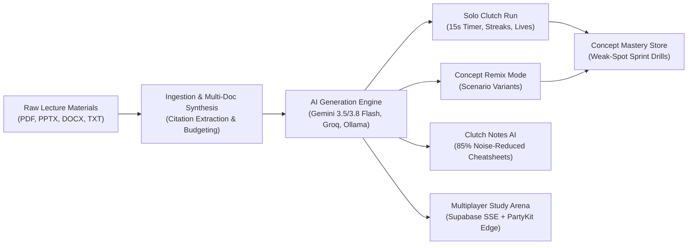
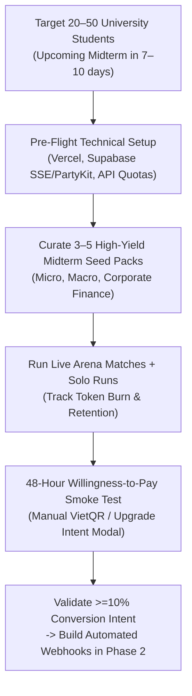
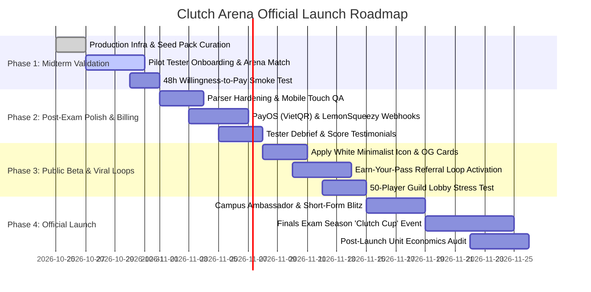

# 🚀 CLUTCH ARENA — Comprehensive Product Specification, Monetization Architecture, and Launch Roadmap

> **Document Version:** 1.1.0  
> **Last Updated:** October 2026  
> **Repository:** `clutch-arena` (v0.2.2)  
> **Stack:** Next.js 15 (App Router), React 19, TypeScript, Tailwind CSS v4, Framer Motion, PartyKit (Edge WebSockets), Supabase (Auth, Postgres & Realtime SSE), Vercel AI SDK 5 (Gemini 3.5/3.8 Flash, Groq Llama 3.3 70B, Ollama), Upstash Redis, KaTeX.

---

## 📋 Table of Contents
1. [Context, Vision & Product Purpose](#1-context-vision--product-purpose)
2. [Brand Identity, Color Palette & Minimalist Icon Specification](#2-brand-identity-color-palette--minimalist-icon-specification)
3. [Current Architecture & Completed Capabilities (v0.2.2)](#3-current-architecture--completed-capabilities-v022)
   - 3.1 [Solo Gamified Active Recall Engine](#31-solo-gamified-active-recall-engine)
   - 3.2 [Document Ingestion & Multi-Format Parsing Suite](#32-document-ingestion--multi-format-parsing-suite)
   - 3.3 [AI Question Generation & Concept Remix](#33-ai-question-generation--concept-remix)
   - 3.4 [Concept Mastery Store & Weak-Spot Sprints](#34-concept-mastery-store--weak-spot-sprints)
   - 3.5 [AI Socratic Coach & Deep Debrief](#35-ai-socratic-coach--deep-debrief)
   - 3.6 [Clutch Notes AI (Slide-to-Summary Cheatsheets)](#36-clutch-notes-ai-slide-to-summary-cheatsheets)
   - 3.7 [Dual-Engine Real-Time Multiplayer Study Arena](#37-dual-engine-real-time-multiplayer-study-arena)
   - 3.8 [Pack Sharing, Portability & 1-Click Study Guides](#38-pack-sharing-portability--1-click-study-guides)
   - 3.9 [Authentication, Cloud Persistence & Guest Migration](#39-authentication-cloud-persistence--guest-migration)
   - 3.10 [Bilingual Internationalization (i18n)](#310-bilingual-internationalization-i18n)
   - 3.11 [Study Space & Multi-Workspace Architecture](#311-study-space--multi-workspace-architecture)
4. [Master Monetization, Viral Gating & Unit Economics Blueprint](#4-master-monetization-viral-gating--unit-economics-blueprint)
   - 4.1 [Dual-Market PPP Pricing & Tier Architecture](#41-dual-market-ppp-pricing--tier-architecture)
   - 4.2 [Why Tutors, TAs & Club Leaders Buy the Guild Tier](#42-why-tutors-tas--club-leaders-buy-the-guild-tier)
   - 4.3 [Geographic Price Discrimination & Payment Infrastructure](#43-geographic-price-discrimination--payment-infrastructure)
   - 4.4 [Zero-CAC Viral Gating Mechanics](#44-zero-cac-viral-gating-mechanics)
   - 4.5 [CFO Unit Economics, Margin Protection & Break-Even](#45-cfo-unit-economics-margin-protection--break-even)
5. [Strategic Evaluation & Venture Risk Mitigations](#5-strategic-evaluation--venture-risk-mitigations)
6. [The Ideas Backlog & Future Horizon](#6-the-ideas-backlog--future-horizon)
7. [Early-Access Midterm Exam Prep & 48-Hour Smoke Test Plan](#7-early-access-midterm-exam-prep--48-hour-smoke-test-plan)
   - 7.1 [Cohort Profile & Midterm Goals](#71-cohort-profile--midterm-goals)
   - 7.2 [Why Automated Billing Code Waits Until Post-Validation](#72-why-automated-billing-code-waits-until-post-validation)
   - 7.3 [Critical Pre-Flight Checklist Before Testers Start](#73-critical-pre-flight-checklist-before-testers-start)
   - 7.4 [Tester Onboarding & Rapid Feedback Loop](#74-tester-onboarding--rapid-feedback-loop)
8. [Roadmap to Next Month's Official Launch](#8-roadmap-to-next-months-official-launch)
9. [Actionable Execution Matrix](#9-actionable-execution-matrix)

---

## 1. Context, Vision & Product Purpose

### 1.1 The Student Dilemma
University exam preparation is fundamentally broken:
- **Slide Bloat & Cognitive Overload:** Students are handed 150–300 slide lecture presentations filled with dense bullet points, unstructured diagrams, and decorative filler.
- **Passive Re-reading Illusion:** Cognitive science repeatedly proves that highlighting notes and re-reading slides yields minimal long-term memory retention, creating a false sense of mastery ("fluency illusion").
- **The 48-Hour Exam Panic & Episodic Churn:** Most students begin intensive study 48 to 72 hours before midterms and final exams. When panic sets in, traditional spaced-repetition tools (like Anki) feel too tedious to configure, and standard monthly SaaS subscriptions suffer $15\%$ to $25\%$ monthly churn the day after finals end.
- **Disconnected Practice & AI Hallucinations:** Generic quiz apps lack **strict grounding**. When an AI hallucinates answers or formulas without exact source page citations, students in high-stakes courses (Finance, Economics, STEM, Pre-Med, Law) lose trust immediately.

### 1.2 The Clutch Arena Solution
**Clutch Arena** transforms bloated academic materials into an adrenaline-fueled, gamified study arena. It unites **NotebookLM’s strict verbatim source verification** with **Kahoot’s synchronous multiplayer adrenaline** and **Concept Remixing**:
1. **High-Intensity Active Recall:** 15-second timed decisions, streak multipliers, and 3 lives create an authentic game-like flow state that destroys exam anxiety.
2. **Concept Remix (Anti-Rote Learning):** Rather than repeating verbatim multiple-choice questions, the engine generates contextual variants (altered numbers, inverted perspectives, new real-world business scenarios) to test true deep comprehension of underlying formulas ($E_d = |\frac{\%\Delta Q}{\%\Delta P}|$, CAPM, DDM).
3. **Verifiable Zero-Hallucination Grounding:** Every question, explanation, and formula cites the exact page, slide, or paragraph from the student's uploaded syllabus.
4. **Instant Distillation (Clutch Notes AI):** Strips $85\%$ of slide fluff, distilling 100 slides into a 2-page cheat sheet equipped with LaTeX formulas, variable breakdowns, and boundary rules.
5. **Competitive Social Gaming (Arena Mode):** Multiplayer live WebSockets and SSE let students battle their classmates in real-time, making studying engaging and zero-CAC viral.



---

## 2. Brand Identity, Color Palette & Minimalist Icon Specification

### 2.1 Production UI Color Palette Analysis
Unlike dark-only gaming apps that feel disconnected from serious academic reading, Clutch Arena’s interface uses a **Warm Academic Paper + High-Voltage Action Accent** palette:

| Role | Color Name | Hex Code | Usage in UI |
| :--- | :--- | :--- | :--- |
| **Primary Canvas** | Warm Alabaster / Paper | `#F7F5EE` | Main workspace background; reduces eye strain during long reading and cramming sessions. |
| **Card & Icon Surface** | Pure Crisp White | `#FFFFFF` | Main interactive quiz setup cards, active modals, header pills, and primary app icon background. |
| **Secondary Surface** | Soft Academic Sage | `#EBF0E6` | Right-hand *15 Core Concepts* panel (`Khái niệm cốt lõi`) and sidebar motivational callout card. |
| **Primary Brand Accent** | Clutch Orange | `#E85D2A` | Primary CTA buttons (`Bắt đầu làm bài`), active navigation tab, `PRO`/`TRỰC TIẾP` badges, and lightning emblem. |
| **Secondary Warm Tint** | Soft Apricot / Amber | `#FFF4EE` | Selected state backgrounds (`10 câu`, `Ôn tập kinh điển`) paired with `#E85D2A` borders. |
| **Primary Typography** | Deep Obsidian Ink | `#18181B` | High-contrast headings (`Bớt lo lắng. Tăng thực hành.`), body text, and the word `clutch` in the wordmark. |
| **Muted / Meta Text** | Warm Slate Gray | `#71717A` | Breadcrumbs, question counts, keyboard shortcut hints, and source metadata. |

### 2.2 White-Background Minimalist Icon & Logo Specification
To align seamlessly with the light-mode workspace and modern iOS/macOS/web icon standards, the official **Clutch Arena** icon follows a strict **flat, minimalist geometric construction (zero neon, zero gradients, zero drop-shadows)**:

- **Background Canvas:** Solid Pure White (`#FFFFFF`) rounded square (squircle).
- **Central Geometric Mark:**
  - **Left Outer Frame:** A bold, sharp-angled hexagonal **"C"** in solid Clutch Orange (`#E85D2A`), representing the *Clutch* arena enclosure.
  - **Right Strike:** A flat, razor-sharp geometric **lightning bolt** in solid Clutch Orange (`#E85D2A`) slicing diagonally through the right side of the "C", symbolizing 15-second speed and high-stakes energy.
  - **Core Negative-Space / Inner Motif:** A minimalist geometric **open book / chevron page** in solid Deep Obsidian Ink (`#18181B`) nested cleanly inside the center of the hexagonal "C", grounding the mark in verified academic study.
- **Wordmark Lockup (`clutch arena`):**
  - Set in a clean, bold geometric sans-serif (`Plus Jakarta Sans` or `Inter Bold`, lowercase).
  - **`clutch`** rendered in solid Deep Obsidian Ink (`#18181B`).
  - **`arena`** rendered in solid Clutch Orange (`#E85D2A`).

```xml
<!-- Minimalist Flat Vector Icon Reference (Pure White Background, No Gradients) -->
<svg xmlns="http://www.w3.org/2000/svg" viewBox="0 0 512 512" width="100%" height="100%">
  <!-- Pure White Squircle Background -->
  <rect width="512" height="512" rx="112" fill="#FFFFFF" stroke="#E4E4E7" stroke-width="4"/>
  
  <!-- Hexagonal 'C' Frame (Clutch Orange) -->
  <path d="M292 116H196L140 212L196 308H264L246 348H172L96 212L172 76H312L292 116Z" fill="#E85D2A"/>
  
  <!-- Sharp Geometric Lightning Bolt (Clutch Orange) -->
  <path d="M356 96L260 220H328L252 364L396 204H324L356 96Z" fill="#E85D2A"/>
  
  <!-- Minimalist Open Book / Academic Core (Deep Obsidian Ink) -->
  <path d="M216 184L252 204L288 184V236L252 256L216 236V184Z" fill="#18181B"/>
  
  <!-- Flat Minimalist Wordmark -->
  <text x="256" y="436" text-anchor="middle" font-family="Inter, Plus Jakarta Sans, sans-serif" font-weight="800" font-size="48" letter-spacing="-1.5">
    <tspan fill="#18181B">clutch </tspan>
    <tspan fill="#E85D2A">arena</tspan>
  </text>
</svg>
```

---

## 3. Current Architecture & Completed Capabilities (v0.2.2)

The platform is in a production-ready technical state with **197 passing automated unit/integration tests** and full TypeScript type safety. Below is an exhaustive breakdown of implemented systems:

### 3.1 Solo Gamified Active Recall Engine
- **Gameplay Mechanics:**
  - **3 Lives System:** Runs start with 3 hearts. Incorrect answers or timer expirations deduct 1 heart; reaching 0 triggers a game over and immediate run review.
  - **15-Second Deadline-Based Timer:** Synchronized timer bar with pause/resume support (`P` key) and background safety guards.
  - **Streak Multipliers:**
    - 1–2 streak: $1.0\times$ (100 XP base).
    - 3–4 streak: $1.5\times$ (150 XP).
    - 5–6 streak: $2.0\times$ (200 XP).
    - $7+$ streak: **ON FIRE** state with specialized HUD animations.
    - An error resets the multiplier back to $1.0\times$.
  - **4-Second Reading Lock:** When an answer is missed, a 4-second forced lock ensures the student reads the correct rule, explanation, and source reference before proceeding.
  - **Dynamic Spaced Review Queue:** Missed questions automatically re-enter the queue, alternating between their original format and their remix scenario variant until the student achieves **2 consecutive correct answers**.
- **User Interface & Controls:**
  - Full keyboard mapping (`1-4` or `A-D` to answer, `Enter`/`Space` to advance, `P` to pause, `M` to mute).
  - Synthesized Web Audio sound effects (synthesizer chords, countdown tick, streak whoosh, error thud).
  - KaTeX LaTeX rendering for complex mathematical, financial, and economic formulas ($P_0 = \frac{D_1}{r - g}$, CAPM, elasticity, etc.).
  - Canvas confetti particle effects on run completion.

### 3.2 Document Ingestion & Multi-Format Parsing Suite
- **Supported Formats:**
  - **PDF:** Page-by-page extraction via `pdf-parse` with preservation of authentic page numbers.
  - **PPTX:** Slide-by-slide XML extraction using `jszip`, preserving slide boundaries and notes.
  - **DOCX:** Paragraph-aware extraction via `mammoth` (using paragraph indices rather than fake page counts).
  - **TXT:** UTF-8 plaintext parsing with line-range indexing.
- **Multi-Document Synthesis:** Upload up to 10 files simultaneously (up to 25MB aggregate) to synthesize an integrated exam review deck spanning textbook chapters, slide decks, and past midterms.
- **Resilient Verifiable Citation Engine:**
  - Every generated question is pinned to a specific source ID, label (e.g., "Slide 14", "Page 8", "Lines 45–60"), and a verbatim excerpt from the student's document.
  - Punctuation-insensitive, cross-page split, ellipsis (`...`), and token n-gram normalized matching prevents citation rejections caused by minor OCR/formatting variations.

### 3.3 AI Question Generation & Concept Remix
- **Model Routing Architecture:**
  - **Google Gemini:** `gemini-3.5-flash-lite` (fast, economical generation for free Contender tier) and `gemini-3.8-flash` (complex reasoning and multi-document synthesis for Cram Pass / Pro tiers).
  - **Groq Integration:** `llama-3.3-70b-versatile` and `qwen/qwen3.8-27b` support for instant automatic failover if Gemini quotas or rate limits are reached.
  - **Local Ollama Support:** `qwen2.5:7b` capability for zero-cloud offline environments.
- **Dual Operating Modes:**
  - **Classic Recall Mode (`Ôn tập kinh điển`):** Strictly maintains original phrasing and options while independently validating source citations.
  - **Concept Remix Mode (`Biến thể câu hỏi - Remix`):** Generates realistic applied scenario questions using altered numbers, alternative industry settings, and counterfactuals to test conceptual mastery rather than answer-key memorization.

### 3.4 Concept Mastery Store & Weak-Spot Sprints
- **Mastery Tracking:** Evaluates every question attempt per topic across 4 mastery tiers:
  - `Mastered` (High accuracy, $\ge 3$ consecutive correct).
  - `Learning` (Moderate accuracy, active progress).
  - `Weak` ($< 60\%$ accuracy or multiple consecutive misses).
  - `Untested` (Fresh content).
- **1-Click Weak-Spot Sprint:** Automatically filters all weak concepts across past runs and compiles an instant 5- to 10-question high-intensity drill pack.
- **Dual-Storage Persistence:** Saves locally to `localStorage` and synchronizes in the background with Supabase PostgreSQL.

### 3.5 AI Socratic Coach & Deep Debrief
- **Socratic Guidance:** Instead of spoon-feeding direct answers, the coach delivers contextual hints, conceptual analogies, and step-by-step thinking guides.
- **Instant Context Injection:** Clicking "Ask Coach" from any feedback card or post-match podium summary automatically injects the active question, user's erroneous choice, correct choice, and supporting document text into the conversation.
- **Document Grounding:** Context windows budget up to 6,000 characters of surrounding slide context to answer follow-up queries with guaranteed verbatim citations.

### 3.6 Clutch Notes AI (Slide-to-Summary Cheatsheets)
- **$85\%$ Noise Reduction:** Automatically condenses 50–100 slide decks into 2–3 pages of high-yield exam notes.
- **Academic Structure:**
  - Executive summary and core principles.
  - Formula boxes with LaTeX expressions, variable glossaries ("Trong đó:"), and units.
  - Model selection rules & boundary pitfalls (e.g., condition $g < r$ for dividend discount models).
- **Watermarked PDF Export:** One-click clean, print-ready PDF styling with institutional headers, page numbering, and copyright watermarking.

### 3.7 Dual-Engine Real-Time Multiplayer Study Arena
- **Zero-Config Production Engine (Default):** Powered by Next.js API routes (`/api/arena/rooms`) and **Supabase Realtime Broadcast + Server-Sent Events (SSE)**. Works directly on Vercel and Supabase without requiring third-party WebSocket hosting.
- **PartyKit / PartyServer Edge Engine:** Built into `party/arena.ts` for sub-30ms edge WebSockets when needed for massive tournament concurrency.
- **Lobby & Room Management:**
  - Room codes with instant link sharing (`/arena?room=ABCD`).
  - Real-time player presence, ready toggles, and live countdown timers.
- **Intelligent Bot Archetypes:** Prevents cold-start empty lobbies when students study solo or in small groups late at night (`TryHard_Alex` / Speed Bot, `Cramming_Sam` / Steady Bot, `Speedy_Linh` / Wildcard Bot).
- **Synchronized Rounds & Live Podium:** Authoritative server manages deadlines, reveals question feedback simultaneously to all players, and calculates a final Olympic-style podium celebration with direct handoff to the AI Coach.

### 3.8 Pack Sharing, Portability & 1-Click Study Guides
- **Zero-Token Client-Side URL Sharing:**
  - Complete study packs are LZ/Deflate-compressed into Base64 URL fragment hashes (`#pack=...`) with zip-bomb decompression guards.
  - Allows students to send study decks across Messenger, Zalo, or Discord with **$0 database and $0 LLM API token cost** and instant import.
- **Study Guide Print Engine:** Generates an immediate printable HTML/PDF document with full answer keys, rationale, and verbatim citations.

### 3.9 Authentication, Cloud Persistence & Guest Migration
- **Supabase PostgreSQL & Auth:** Full user authentication with email/password and session management.
- **Row-Level Security (RLS):** Strictly isolates user study packs, run histories, concept mastery scores, and subscription statuses.
- **Guest-to-Cloud Migration:** Decks and runs completed anonymously before signing up are automatically transferred into the newly authenticated account upon registration.

### 3.10 Bilingual Internationalization (i18n)
- Comprehensive English (`en`) and Vietnamese (`vi`) localization across all top-level tabs, gameplay HUDs, feedback cards, coach prompts, and pricing dialogs with an instant header toggle.

### 3.11 Study Space & Multi-Workspace Architecture
- **Current Foundation (v0.2.2):** Sidebar workspace indicator (`Không gian học tập — Thêm một câu. Tiến một bước.`).
- **Multi-Tenant Evolution (v0.3.0+):** Interactive **Multi-Workspace Switcher** enabling Tutor/Guild tier hosts to manage dedicated class spaces, issue 6-character join codes, and isolate shared decks and class mastery heatmaps via Supabase RLS.

---

## 4. Master Monetization, Viral Gating & Unit Economics Blueprint

Consumer EdTech startups fail when they rely solely on a flat Western monthly subscription that students cancel the day after finals (**episodic churn**). Clutch Arena solves this by combining **PPP-adjusted regional tiers**, **one-time micro-transaction Cram Passes**, **4-month Semester Passes**, and **zero-CAC viral gating**.

### 4.1 Dual-Market PPP Pricing & Tier Architecture

| Tier | Global Price (USD) | Vietnam Price (VND) | Core Access, Lobby Caps & Feature Gates | Strategic Purpose |
| :--- | :--- | :--- | :--- | :--- |
| **Contender (Free)** | **`$0`** | **`0đ`** | • 2 document uploads/week (max 1 file/upload, 10Q/run)<br>• Classic Recall mode only<br>• **Host Cap:** Max 4–8 players per `/arena` lobby<br>• **Unlimited Joining** of any `/arena` room & **Unlimited Importing** of shared Base64 packs | Zero-friction viral onboarding. Every free user can join friends' games or study shared packs at `$0` AI token cost. |
| **7-Day Cram Pass** *(One-Time)* | **`$3.99`** | **`69,000đ`** | • 7 days of full Pro access (no recurring billing trap)<br>• Multi-doc synthesis (10 files / 25MB)<br>• 30-question runs + **Concept Remix** + **Clutch Notes AI**<br>• Unlimited AI Socratic Coach Debriefs<br>• **Host Cap:** Up to 15 players per `/arena` lobby | Monetizes the $60\%$ of students who refuse recurring subscriptions but impulse-buy 48 hours before a midterm or final exam. |
| **Clutch Pro** *(Monthly / Semester)* | **`$7.99/mo`** or **`$29/sem`** *(4 mos)* | **`99,000đ/mo`** or **`299,000đ/sem`** | • Everything in Cram Pass continuously<br>• **Host Privileges:** Host `/arena` rooms (up to 15 players) where free friends play your custom 30Q remixed decks<br>• 1-Click PDF "Missed Questions + Citations" Cheat Sheet Export | Locks in 4-month Semester LTV upfront to eliminate post-midterm subscription churn across the academic term. |
| **Tutor / Guild Tier** | **`$19.99/mo`** | **`399,000đ/mo`** | • **Large Classroom Lobbies:** Host **30 to 100+ concurrent players** in `/arena`<br>• **Post-Match Class Analytics & Gradebook Export**<br>• **Custom Branded Base64 Packs** (Tutor logo, name & enrollment CTA)<br>• **Persistent Guild Room Codes** (e.g., `ECO101`, `IELTS8`) | High-retention B2B2C revenue from IELTS, SAT, and university tutors/TAs running live review classes. |

### 4.2 Why Tutors, TAs & Club Leaders Buy the Guild Tier (`$19.99` / `399,000đ`)
Students never need to buy the Guild Tier to join a big match—all joiners play free on Contender accounts. Tutors and academic club leaders upgrade to the Guild Tier because of **Host Capacities and Classroom Visibility**:
1. **Breaking the Room Size Cap (30–100+ Players):** Free hosts cap at 8 players and Student Pro hosts cap at 15 players. A private tutor or TA running a live review session for 40 students requires the Guild Tier so the 16th+ student isn't blocked by a "Room Full" gate.
2. **Post-Match Class Analytics Dashboard:** Standard students only see the podium and their own mistakes. Guild Hosts get a class-wide diagnostic breakdown (e.g., *"78% of your 35 students missed Question 12 on Price Elasticity, and these 6 students lost all 3 hearts before Round 5"*), telling the teacher exactly what to re-teach immediately.
3. **Branded Study Packs as a Lead-Generation Funnel:** Private tutors in Vietnam and globally share free study materials on Zalo, Facebook, and Discord to recruit students. Guild Tier lets them stamp their branding and class registration link onto every shared `#pack=...` URL and `/arena` lobby.

### 4.3 Geographic Price Discrimination & Payment Infrastructure
- **Vietnam Market (`vi` locale / VND):**
  - Less than $15\%$ of Vietnamese university students own international Visa/Mastercard credit cards.
  - Integrated with **PayOS** or **SePay** to generate dynamic **VietQR** codes (`https://img.vietqr.io/...`), enabling instant 3-second scan-to-pay via MoMo, ZaloPay, or any domestic banking app.
  - Price anchors (`69,000đ` Cram Pass = ~2 milk teas; `299,000đ` Semester Pass) match local student allowances to drive high-volume campus adoption.
- **Global Market (`en` locale / USD):**
  - Automatic IP and locale detection displays USD pricing (`$3.99` Cram Pass, `$7.99/mo`, `$29/sem`).
  - Integrated with **LemonSqueezy** or **Polar.sh** as Merchant of Record to handle Apple Pay, Google Pay, international cards, and global VAT/sales tax compliance automatically.

### 4.4 Zero-CAC Viral Gating Mechanics
The golden rule of Clutch Arena’s architecture: **strictly gate features that consume LLM API tokens** (Document Ingestion, Concept Remix, Clutch Notes AI, AI Coach), and **keep features that distribute the product completely free**:
1. **The "Host-Pays, Friends-Play-Free" Multiplayer Rule:** Anyone can join a room code in `/arena` for free, even if the match runs 30 Concept Remix questions synthesized from 10 complex PDFs. Only the **Room Host** needs a Cram Pass or Pro account to launch that custom match—turning every paying user into an evangelist inside their study group.
2. **Zero-Token Base64 Pack Distribution:** Importing and playing a compressed `#pack=...` link costs `$0` in Gemini or Groq tokens because the questions and citations are already compressed inside the URL hash. Free users play shared packs in Classic mode for free, and see an upgrade/referral prompt only when clicking **"Concept Remix"** or **"Ask AI Coach."**
3. **Earn-Your-Pass Referral Loop:** Price-sensitive students can unlock **3 free Concept Remix runs (or a 48h Cram Pass)** by hosting a 4-player `/arena` match or having 3 classmates import their shared Base64 study pack link.

### 4.5 CFO Unit Economics, Margin Protection & Break-Even

| Unit Metric (Blended Global + VN Paying User) | Per Paying User / Month | $\%$ of Revenue |
| :--- | :--- | :--- |
| **Blended Gross Revenue (ARPPU)** | **`$6.50`** | $100.0\%$ |
| Direct AI API COGS (Gemini Flash + Groq Failover; ~25 packs + 40 Coach turns) | `- $0.42` | $6.5\%$ |
| Realtime Infrastructure (Supabase SSE / Hosting) | `- $0.18` | $2.8\%$ |
| Payment Gateway Fees (PayOS / LemonSqueezy blended) | `- $0.45` | $6.9\%$ |
| **Direct Contribution Margin** | **`$5.45`** | **$83.8\%$** |
| Free-Tier LLM Buffer ($15:1$ Free-to-Paid ratio at `$0.03`/free user) | `- $0.45` | $6.9\%$ |
| **Net Contribution Margin (After Free-Tier Burden)** | **`$5.00`** | **$76.9\%$** |

- **Fixed Monthly Overhead (Lean Setup):** `$370/month` (`$45` Vercel Pro + Supabase Pro base, `$25` Domain/Telemetry, `$300` Campus Creator Seeding).
- **Infrastructure Break-Even Point:** $\frac{\$370}{\$5.00} = \mathbf{74\text{ Paying Subscribers}}$ (~2.5 new subscribers/day).
- **Ramen Profitability (`$3,000/mo` Founder Draw):** $\frac{\$3,370}{\$5.00} = \mathbf{674\text{ Paying Subscribers}}$.
- **Cost Protection Guardrails:**
  - Client-side caching (`localStorage` + Base64 URL tokens) ensures repeat runs never re-trigger LLM calls.
  - Free Contender generations route strictly to `gemini-3.5-flash-lite` / Groq with Upstash Redis IP/user rate limits.
  - Idle SSE/Supabase Realtime channels auto-disconnect after 90 seconds of inactivity.

---

## 5. Strategic Evaluation & Venture Risk Mitigations

| Strategic Lens | Rating | Core Strength | Primary Risk & Built-In Mitigation |
| :--- | :--- | :--- | :--- |
| **Offers Lens** *(Hormozi)* | **$7.5 / 10$** | Ultra-low time delay (PDF to 15s pressure battle in $<60$ seconds); zero-hallucination trust. | **Risk:** "Studying better" is a vitamin until exam week. **Mitigation:** Position around guaranteed exam-ready outcomes via the 7-Day Cram Pass & 2-Page Clutch Notes Cheat Sheet. |
| **Monopoly Lens** *(Thiel)* | **$5.0 / 10$** | Combines NotebookLM citation rigor with Kahoot social energy and numerical Concept Remixing. | **Risk:** Horizontal AI flashcard wrappers are commoditized. **Mitigation:** Dominate high-stakes quantitative/technical verticals (Finance, Econ, STEM, VN National/Uni Exams) and build local network density via `#pack=` links. |
| **Product Lens** *(Jobs)* | **$8.0 / 10$** | End-to-end closed loop: `Upload -> 15s Battle -> Miss Question -> Socratic Coach Debrief -> Weak-Spot Sprint -> Rematch`. | **Risk:** Cold-start empty multiplayer lobbies. **Mitigation:** Built-in AI Practice Bots (`TryHard_Alex`, `Cramming_Sam`, `Speedy_Linh`) guarantee instant competitive tension even at 2:00 AM solo. |

---

## 6. The Ideas Backlog & Future Horizon

The following features are prioritized for post-validation releases (v0.3.0+):

| Idea / Feature | Description | Impact | Target Phase |
| :--- | :--- | :--- | :--- |
| **Study Space Multi-Workspace Switcher** | Interactive workspace switcher enabling Tutor/Guild tier hosts to manage class spaces, issue 6-character invite codes, and scope decks/notes/arenas per group with class accuracy analytics. | Very High | Phase 2 / v0.3 |
| **Mock Midterm Exam Simulator** | 45–60 minute timed exam simulation matching university formats with negative marking, question flagging, and predicted grade calculation (e.g., *"Predicted score: $8.5/10$"*). | High | Phase 2 / v0.3 |
| **LMS Direct Import (Canvas / Blackboard / Moodle)** | Direct OAuth connector allowing students to pull lecture PDFs directly from their university course portals. | Very High | Phase 3 |
| **University Guild Leaderboards** | Campus-level competition (e.g., UEH vs. RMIT vs. FTU vs. HUST) tracking total study XP and weekly arena champions. | High (Viral) | Phase 3 |
| **Formula & Diagram OCR Vision** | Specialized multimodal OCR parsing handwritten lecture notes, whiteboards, and math graph screenshots. | Medium | Phase 3 |
| **Voice AI Cram Coach (Gemini Live)** | Hands-free audio debriefing via WebSocket voice streaming for students commuting right before their exam. | High | Phase 4 |
| **Spaced Repetition Algorithm (FSRS / SM-2)** | Automated long-term retention scheduling for multi-semester certifications (CFA, ACCA, IELTS). | Medium | Phase 4 |

---

## 7. Early-Access Midterm Exam Prep & 48-Hour Smoke Test Plan

### 7.1 Cohort Profile & Midterm Goals
- **Target Size:** 20 to 50 active university students (starting with Vietnamese universities such as UEH, RMIT, FTU, or study groups).
- **Target Courses:** High-stakes quantitative or conceptual courses with upcoming midterms (*Principles of Microeconomics / Macroeconomics*, *Corporate Finance / Cost of Capital*, *Financial Accounting*).

### 7.2 Why Automated Billing Code Waits Until Post-Validation
**Critical Engineering Rule for Phase 1:** Do **not** spend engineering cycles writing automated PayOS/SePay or LemonSqueezy billing webhooks before the initial 20–50 student cohort completes their midterm prep.
1. **Measure Real Token Burn & Usage Ratios First:** Use Phase 1 to observe actual token consumption per student, Solo vs. Arena session ratios, and parser edge cases on real university slides.
2. **Run the Zero-Code 48-Hour Willingness-to-Pay Smoke Test:**
   - Give initial pilot testers full access or let free users hit a lightweight "Smoke Test" modal after their 3rd Concept Remix / Clutch Notes generation:
     > *"Unlock the 7-Day Midterm Cram Pass (`69,000đ` / `$3.99`) for unlimited Concept Remix & 10-File Synthesis."*
   - Use either a simple manual VietQR transfer (where you flip `tier = 'cram_pass'` in Supabase) or a 1-click "Request Early Access" intent tracker.
   - **Validation Threshold:** If $\ge 10\%$ of active midterm testers initiate payment or request upgrade unlocks within 48 hours of their exam, automated billing webhooks are green-lit for Phase 2.



### 7.3 Critical Pre-Flight Checklist Before Testers Start
- [ ] **1. Production Deployment & Live URLs:**
  - Frontend deployed on Vercel (`https://clutcharena.vercel.app` or custom domain).
  - Verify default zero-config multiplayer engine (Supabase Realtime + SSE) or deploy PartyKit (`npx partykit deploy` with `NEXT_PUBLIC_PARTYKIT_HOST`).
  - Supabase production instance initialized with SQL migrations applied (`20261017_auth_and_decks.sql`, `20261018_tier_and_subscriptions.sql`).
- [ ] **2. Production API Keys & Quota Safeguards:**
  - Confirm `GEMINI_API_KEY` has paid tier / high rate limits enabled in Google AI Studio to prevent `429 Too Many Requests` during group study blitzes.
  - Set `GROQ_API_KEY` as automated instant failover.
  - Configure Upstash Redis (`UPSTASH_REDIS_REST_URL`, `UPSTASH_REDIS_REST_TOKEN`) for rate-limiting protection.
- [ ] **3. Midterm Seed Decks (Zero Empty-State Friction):**
  - Pre-load 3–5 high-yield study packs (e.g., *Chapter 12: Estimating the Cost of Capital*, *Microeconomics Elasticity*) into the default public library so testers can play within 10 seconds of landing.
- [ ] **4. Whitelist Pilot Testers / Smoke Test Tracking:**
  - Grant pilot cohort access via SQL or track upgrade clicks in Supabase:
    ```sql
    UPDATE public.profiles SET tier = 'cram_pass', tier_expires_at = now() + interval '14 days' 
    WHERE email IN ('tester1@gmail.com', 'tester2@gmail.com');
    ```
- [ ] **5. In-App Feedback & Citation Rejection Telemetry:**
  - Log any questions stripped by the citation verifier and provide a 1-click "Report Issue / Feedback" link to a dedicated Zalo/Discord pilot group.

### 7.4 Tester Onboarding & Rapid Feedback Loop
1. **Kickoff Day (Day 1):** Share a 60-second screen-recorded video showing a boring PDF slide transforming into a 15-second Clutch Run, followed by a live **15-minute multiplayer `/arena` tournament** with the cohort.
2. **Midterm Cram Window (Days 2–5):** Students upload their own course decks and share `#pack=...` links in their class Zalo/Discord groups. Monitor daily active runs, token burn per user, and parser edge cases.
3. **Post-Midterm Debrief (Days 6–7):** Collect exam score improvements, verbatim testimonials, and willingness-to-pay conversion data.

---

## 8. Roadmap to Next Month's Official Launch



- **Phase 1: Early-Access Midterm Validation (Days 1–7):** Validate core gameplay retention, citation accuracy, zero-cost `#pack=` sharing, and willingness-to-pay with 20–50 real students before writing billing webhook code.
- **Phase 2: Post-Exam Polish & Automated Regional Billing (Days 8–14):** Harden PDF/PPTX parser edge cases, optimize mobile touch targets, and integrate automated **PayOS/SePay (VietQR)** for Vietnam and **LemonSqueezy/Polar.sh** for Global USD checkouts.
- **Phase 3: Public Beta & Zero-CAC Growth Engine (Days 15–21):** Roll out the new white-background minimalist brand icon across favicons/OG cards, activate the *"Host 4-Player Match / Share Pack to Unlock 3 Free Concept Remix Runs"* viral loop, and stress-test 30+ player Tutor/Guild lobbies.
- **Phase 4: Official Launch & Finals Season Campaign (Days 22–30):** Launch short-form POV video blitz on TikTok/Reels, seed pre-built exam packs into university Zalo/Discord groups via Campus Ambassadors, and host the inter-university **"Clutch Cup"** tournament.

---

## 9. Actionable Execution Matrix

| Task | Category | Priority | Dependencies | Status / Action Needed |
| :--- | :--- | :--- | :--- | :--- |
| **Verify Arena Multiplayer (Supabase SSE)** | Infra | 🔴 P0 | Supabase project | Default zero-config engine runs on Vercel + Supabase Realtime without external server cost. |
| **Deploy Next.js Production Build to Vercel** | Infra | 🔴 P0 | GitHub repo | Connect repo to Vercel; configure `.env` secrets and Upstash Redis rate limits. |
| **Verify Gemini Quotas & Groq Failover** | AI Core | 🔴 P0 | API accounts | Ensure paid tier Gemini Flash limits + Groq Llama 3.3 70B instant fallback for 50 concurrent testers. |
| **Curate 3–5 Midterm Seed Packs** | Content | 🔴 P0 | Course materials | Pre-load Corporate Finance & Microeconomics decks so new users have zero empty-state friction. |
| **Run 48h Willingness-to-Pay Smoke Test** | Validation| 🔴 P0 | Pilot cohort | Test `69,000đ` / `$3.99` Cram Pass conversion intent manually before coding payment webhooks. |
| **Update App Favicon & Manifest to White Icon**| Brand | 🟡 P1 | SVG asset | Apply the new white-background minimalist hexagonal-C + lightning bolt icon across web & mobile. |
| **Mobile Webview & Touch QA (Zalo/FB Browser)**| Frontend | 🟡 P1 | Mobile devices | Verify `#pack=...` links and 15s timer buttons work seamlessly inside Zalo, Messenger, and iOS Safari. |
| **Implement Lobby Cap & Idle SSE Disconnect** | Cost Guard| 🟡 P1 | Arena API | Enforce 8-player free host cap, 15-player Pro cap, 30+ Guild cap, and 90s idle SSE disconnect. |
| **Integrate PayOS (VN) & LemonSqueezy (Global)**| Billing | 🟡 P1 | Smoke Test Pass | Automate dual-region PPP checkouts (`vi` -> VietQR, `en` -> USD Merchant of Record) in Phase 2. |
| **Build Tutor/Guild Post-Match Class Analytics**| Product | 🟢 P2 | Arena Summary | Add Host Dashboard showing missed-question percentages across all classroom joiners. |
| **Host 'Clutch Cup' Finals Launch Tournament** | Growth | 🟢 P2 | Campus Reps | Run inter-university live review tournament 10 days before final exams. |

---

*Document maintained by the Clutch Arena Core Team. Keep this file updated as validation stages conclude and milestones are achieved.*