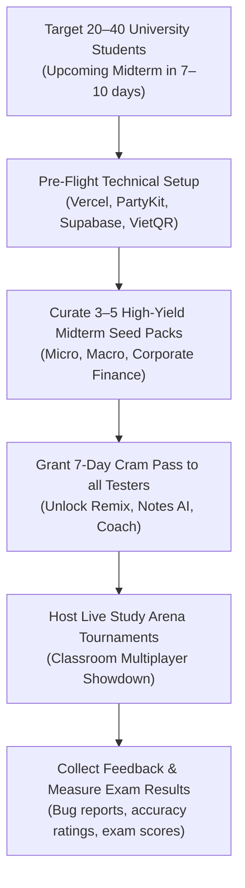
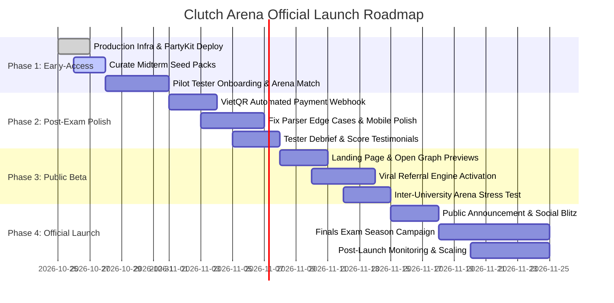

# 🚀 CLUTCH ARENA — Comprehensive Product Specification, Capabilities, and Launch Roadmap

> **Document Version:** 1.0.0  
> **Last Updated:** October 2026  
> **Repository:** `clutch-arena` (v0.2.2)  
> **Stack:** Next.js 15 (App Router), React 19, TypeScript, Tailwind CSS v4, Framer Motion, PartyKit (Edge WebSockets), Supabase (Auth & Postgres), Vercel AI SDK 5 (Gemini 3.5/3.8 Flash, Groq, Ollama), Upstash Redis, KaTeX.

---

## 📋 Table of Contents
1. [Context, Vision & Product Purpose](#1-context-vision--product-purpose)
2. [Current Architecture & Completed Capabilities (v0.2.2)](#2-current-architecture--completed-capabilities-v022)
   - 2.1 [Solo Gamified Active Recall Engine](#21-solo-gamified-active-recall-engine)
   - 2.2 [Document Ingestion & Multi-Format Parsing Suite](#22-document-ingestion--multi-format-parsing-suite)
   - 2.3 [AI Question Generation & Concept Remix](#23-ai-question-generation--concept-remix)
   - 2.4 [Concept Mastery Store & Weak-Spot Sprints](#24-concept-mastery-store--weak-spot-sprints)
   - 2.5 [AI Socratic Coach & Deep Debrief](#25-ai-socratic-coach--deep-debrief)
   - 2.6 [Clutch Notes AI (Slide-to-Summary Cheatsheets)](#26-clutch-notes-ai-slide-to-summary-cheatsheets)
   - 2.7 [Edge Real-Time Multiplayer Study Arena](#27-edge-real-time-multiplayer-study-arena)
   - 2.8 [Pack Sharing, Portability & 1-Click Study Guides](#28-pack-sharing-portability--1-click-study-guides)
   - 2.9 [Authentication, Cloud Persistence & Guest Migration](#29-authentication-cloud-persistence--guest-migration)
   - 2.10 [Student-Centric Monetization (PPP & VietQR)](#210-student-centric-monetization-ppp--vietqr)
   - 2.11 [Bilingual Internationalization (i18n)](#211-bilingual-internationalization-i18n)
   - 2.12 [Study Space & Multi-Workspace Architecture (Tutor & Study Groups)](#212-study-space--multi-workspace-architecture-tutor--study-groups)
3. [The Ideas Backlog & Future Horizon](#3-the-ideas-backlog--future-horizon)
4. [Early-Access Midterm Exam Prep Plan (Immediate Target)](#4-early-access-midterm-exam-prep-plan-immediate-target)
   - 4.1 [Cohort Profile & Midterm Goals](#41-cohort-profile--midterm-goals)
   - 4.2 [Critical Pre-Flight Checklist Before Testers Start](#42-critical-pre-flight-checklist-before-testers-start)
   - 4.3 [Tester Onboarding & Rapid Feedback Loop](#43-tester-onboarding--rapid-feedback-loop)
5. [Roadmap to Next Month's Official Launch](#5-roadmap-to-next-months-official-launch)
   - [Phase 1: Early-Access Midterm Testing (Days 1–7)](#phase-1-early-access-midterm-testing-days-17)
   - [Phase 2: Post-Exam Debrief & Polish (Days 8–14)](#phase-2-post-exam-debrief--polish-days-814)
   - [Phase 3: Public Beta & Growth Engine (Days 15–21)](#phase-3-public-beta--growth-engine-days-1521)
   - [Phase 4: Official Launch & Finals Season Campaign (Days 22–30)](#phase-4-official-launch--finals-season-campaign-days-2230)
6. [Actionable Execution Matrix](#6-actionable-execution-matrix)

---

## 1. Context, Vision & Product Purpose

### 1.1 The Student Dilemma
University exam preparation is fundamentally broken:
- **Slide Bloat & Cognitive Overload:** Students are handed 150–300 slide lecture presentations filled with dense bullet points, unstructured diagrams, and decorative filler.
- **Passive Re-reading Illusion:** Cognitive science repeatedly proves that highlighting notes and re-reading slides yields minimal long-term memory retention, creating a false sense of mastery ("fluency illusion").
- **The 48-Hour Exam Panic:** Most students begin intensive study 48 to 72 hours before midterms and final exams. When panic sets in, traditional spaced-repetition tools (like Anki) feel too tedious, rigid, and time-consuming to configure.
- **Disconnected Practice:** Generic quiz apps lack **strict grounding**. When an AI hallucinate answers without exact source page citations, students lose trust immediately.

### 1.2 The Clutch Arena Solution
**Clutch Arena** transforms bloated academic materials into an adrenaline-fueled, gamified study arena. It fuses:
1. **High-Intensity Active Recall:** 15-second timed decisions, streak multipliers, and 3 lives create an authentic game-like flow state that destroys exam anxiety.
2. **Concept Remix (Anti-Rote Learning):** Rather than repeating verbatim multiple-choice questions, the engine generates contextual variants (altered numbers, inverted perspectives, new real-world business scenarios) to test true deep comprehension.
3. **Verifiable Grounding:** Every question, explanation, and formula cites the exact page, slide, or paragraph from the student's uploaded syllabus.
4. **Instant Distillation (Clutch Notes AI):** Strips 85% of slide fluff, distilling 100 slides into a 2-page cheat sheet equipped with LaTeX formulas, variable breakdowns, and boundary rules.
5. **Competitive Social Gaming (Arena Mode):** Multiplayer live edge WebSockets let students battle their classmates in real-time, making studying engaging and viral.


---

## 2. Current Architecture & Completed Capabilities (v0.2.2)

The platform is in a robust, high-performance state with **197 passing automated unit/integration tests** and full TypeScript type safety. Below is an exhaustive breakdown of implemented systems:

### 2.1 Solo Gamified Active Recall Engine
- **Gameplay Mechanics:**
  - **3 Lives System:** Runs start with 3 hearts. Incorrect answers or timer expirations deduct 1 heart; reaching 0 triggers a game over and immediate run review.
  - **15-Second Deadline-Based Timer:** Synchronized timer bar with pause/resume support (`P` key) and background safety guards.
  - **Streak Multipliers:**
    - 1–2 streak: 1.0× (100 XP base).
    - 3–4 streak: 1.5× (150 XP).
    - 5–6 streak: 2.0× (200 XP).
    - 7+ streak: **ON FIRE** state with specialized HUD animations.
    - An error resets the multiplier back to 1.0×.
  - **4-Second Reading Lock:** When an answer is missed, a 4-second forced lock ensures the student reads the correct rule, explanation, and source reference before proceeding.
  - **Dynamic Spaced Review Queue:** Missed questions automatically re-enter the queue, alternating between their original format and their remix scenario variant until the student achieves **2 consecutive correct answers**.
- **User Interface & Controls:**
  - Full keyboard mapping (`1-4` or `A-D` to answer, `Enter`/`Space` to advance, `P` to pause, `M` to mute).
  - Synthesized Web Audio sound effects (synthesizer chords, countdown tick, streak whoosh, error thud).
  - KaTeX LaTeX rendering for complex mathematical, financial, and economic formulas ($P_0 = \frac{D_1}{r - g}$, CAPM, elasticity, etc.).
  - Canvas confetti particle effects on run completion.

### 2.2 Document Ingestion & Multi-Format Parsing Suite
- **Supported Formats:**
  - **PDF:** Page-by-page extraction via `pdf-parse` with preservation of authentic page numbers.
  - **PPTX:** Slide-by-slide XML extraction using `jszip`, preserving slide boundaries and notes.
  - **DOCX:** Paragraph-aware extraction via `mammoth` (using paragraph indices rather than fake page counts).
  - **TXT:** UTF-8 plaintext parsing with line-range indexing.
- **Multi-Document Synthesis:** Upload up to 10 files simultaneously (up to 25MB aggregate) to synthesize an integrated exam review deck spanning textbook chapters, slide decks, and past midterms.
- **Resilient Verifiable Citation Engine:**
  - Every generated question is pinned to a specific source ID, label (e.g., "Slide 14", "Page 8", "Lines 45–60"), and a verbatim excerpt from the student's document.
  - Punctuation-insensitive and whitespace-normalized matching prevents citation rejections caused by minor OCR/formatting variations.

### 2.3 AI Question Generation & Concept Remix
- **Model Routing Architecture:**
  - **Google Gemini:** `gemini-3.5-flash-lite` (fast, economical generation) and `gemini-3.8-flash` (complex reasoning and multi-document synthesis).
  - **Groq Integration:** `llama-3.3-70b-versatile` and `qwen/qwen3.8-27b` support for fallback resilience.
  - **Local Ollama Support:** `qwen2.5:7b` capability for zero-cloud offline environments.
  - **Tiered Routing:** Pro & Cram Pass users automatically receive priority routing to top-tier reasoning models.
- **Dual Operating Modes:**
  - **Exact Mode:** Strictly maintains existing testbank phrasing and options while independently validating source citations.
  - **Concept Remix Mode:** Generates realistic applied scenario questions using altered numbers, alternative industry settings, and counterfactuals to test conceptual mastery.

### 2.4 Concept Mastery Store & Weak-Spot Sprints
- **Mastery Tracking:** Evaluates every question attempt per topic across 4 mastery tiers:
  - `Mastered` (High accuracy, $\ge 3$ consecutive correct).
  - `Learning` (Moderate accuracy, active progress).
  - `Weak` ($< 60\%$ accuracy or multiple consecutive misses).
  - `Untested` (Fresh content).
- **1-Click Weak-Spot Sprint:** Automatically filters all weak concepts across past runs and compiles an instant 5- to 10-question high-intensity drill pack.
- **Dual-Storage Persistence:** Saves locally to `localStorage` and synchronizes in the background with Supabase PostgreSQL.

### 2.5 AI Socratic Coach & Deep Debrief
- **Socratic Guidance:** Instead of spoon-feeding direct answers, the coach delivers contextual hints, conceptual analogies, and step-by-step thinking guides.
- **Instant Context Injection:** Clicking "Ask Coach" from any feedback card or run summary automatically injects the active question, user's erroneous choice, correct choice, and supporting document text into the conversation.
- **Document Grounding:** Context windows budget up to 6,000 characters of surrounding slide context to answer follow-up queries accurately.

### 2.6 Clutch Notes AI (Slide-to-Summary Cheatsheets)
- **85% Noise Reduction:** Automatically condenses 50–100 slide decks into 2–3 pages of high-yield exam notes.
- **Academic Structure:**
  - Executive summary and core principles.
  - Formula boxes with LaTeX expressions, variable glossaries ("Trong đó:"), and units.
  - Model selection rules & boundary pitfalls (e.g., condition $g < r$ for dividend discount models).
- **Watermarked PDF Export:** One-click clean, print-ready PDF styling with institutional headers, page numbering, and copyright watermarking.
- **Interactive Before/After Modal:** Side-by-side comparison illustrating bloated PowerPoint slides alongside distilled exam cheat sheets.

### 2.7 Multiplayer Study Arena (Dual-Engine: Supabase Realtime + PartyKit / PartyServer)
- **Zero-Config Production Engine (Default):** Powered by Next.js API routes (`/api/arena/rooms`) and **Supabase Realtime Broadcast + Server-Sent Events (SSE)**. Works directly on Vercel and your existing Supabase database without requiring third-party WebSocket hosting.
- **PartyKit / PartyServer Edge Engine:** Built into `party/arena.ts` for sub-30ms edge WebSockets (runs locally on port 1999 via `npm run party:dev`, or deployable to your own Cloudflare Workers account via PartyServer).
- **Lobby & Room Management:**
  - 4-letter alphanumeric room codes with instant link sharing (`/arena?room=ABCD`).
  - Real-time player presence, ready toggles, and live countdown timers.
- **Intelligent Bot Archetypes:** If students study alone or late at night, AI bots fill the lobby:
  - `TryHard_Alex`: Fast response, 90% accuracy.
  - `Cramming_Sam`: Moderate speed, 70% accuracy.
  - `Speedy_Linh`: Instant answer, 60% accuracy.
- **Synchronized Rounds & Live Podium:** Authoritative server manages deadlines, reveals question feedback simultaneously to all players, and calculates a final Olympic-style podium celebration.

### 2.8 Pack Sharing, Portability & 1-Click Study Guides
- **Zero-Token Client-Side URL Sharing:**
  - Complete study packs are LZ-compressed into Base64 URL fragment hashes (`#pack=...`).
  - Allows students to send study decks across Messenger, Zalo, or Discord with **zero database cost** and instant import.
- **Study Guide Print Engine:** Generates an immediate printable HTML/PDF document with full answer keys, rationale, and citations.

### 2.9 Authentication, Cloud Persistence & Guest Migration
- **Supabase PostgreSQL & Auth:** Full user authentication with email/password and session management.
- **Row-Level Security (RLS):** Strictly isolates user study packs, run histories, concept mastery scores, and subscription statuses.
- **Guest-to-Cloud Migration:** Decks and runs completed anonymously before signing up are automatically transferred into the newly authenticated account upon registration.

### 2.10 Student-Centric Monetization (PPP & VietQR)
- **Pricing Tiers Adjusted for Student Purchasing Power (PPP):**
  - **Contender (Free):** 2 uploads/week, 10Q classic runs, unlimited joining of multiplayer rooms, unlimited Base64 pack importing.
  - **7-Day Cram Pass (69.000đ / $3.99 one-time):** Designed specifically for 48h exam week sprints. Unlocks unlimited Clutch Notes AI, Concept Remix, 30Q runs, and AI Coach without recurring subscription traps.
  - **Clutch Pro Semester (299.000đ / $29 for 4 months):** Full host privileges for multiplayer rooms, cloud sync across all devices, 30 notes/day.
  - **Tutor & Guild (399.000đ / month):** Tailored for university teaching assistants and student clubs.
- **VietQR Dynamic Generator:**
  - Integrates MBBank dynamic QR rendering (`https://img.vietqr.io/...`) embedding exact transfer amounts and randomized reference codes (`CLUTCH PRO XXXXX`).
- **Viral Referral Engine:** Hosting 4-player arena matches or getting classmates to import shared packs automatically awards free 48h Cram Passes.

### 2.11 Bilingual Internationalization (i18n)
- Comprehensive English (`en`) and Vietnamese (`vi`) localization across all top-level tabs, gameplay HUDs, feedback cards, coach prompts, and pricing dialogs.

### 2.12 Study Space & Multi-Workspace Architecture (Tutor & Study Groups)
- **Current Foundation (v0.2.2):**
  - Sidebar workspace indicator: `Your study space` with avatar badge `S` and motivational motto *"One more rep. One step closer."* (Vietnamese: *"Không gian học tập — Thêm một câu. Tiến một bước."*).
- **Multi-Tenant Evolution (v0.3.0+):**
  - Upgrades from a static status badge into an interactive **Multi-Workspace Switcher** (modeled after Slack, Notion, and Linear).
  - Designed specifically for the **Tutor Tier (Giảng Viên & Nhóm Học)**:
    - **Class & Study Group Workspaces:** Tutors and study groups create dedicated collaborative study spaces (e.g., *FIN301 Corporate Finance - Dr. Minh's Class*).
    - **Asset Scoping & RLS Isolation:** Shared lecture slide decks, curated exam testbanks, group-specific Clutch Notes, and member progress are scoped to `workspace_id` under Supabase Row-Level Security.
    - **Zero-Friction 6-Character Join Codes:** Students join group workspaces via alphanumeric codes (e.g. `CLU-789`) or 1-click invite links.
    - **Group Arena Tournaments:** Host closed, class-exclusive live multiplayer arenas with aggregate class mastery heatmaps.

---

## 3. The Ideas Backlog & Future Horizon

The following conceptual features are identified for post-launch releases (v0.3.0+):

| Idea / Feature | Description | Impact | Target Phase |
| :--- | :--- | :--- | :--- |
| **Study Space Multi-Workspace Switcher** | Interactive workspace switcher enabling Tutor tier users to manage class spaces, issue 6-character invite codes, and scope decks/notes/arenas per group. | Very High | Phase 2 / v0.3 |
| **Mock Midterm Exam Simulator** | 45-60 minute timed exam simulation matching university formats with negative marking, question flagging, and predicted grade calculation (e.g. "Predicted score: 8.5/10"). | High | Phase 2 / v0.3 |
| **LMS Direct Import (Canvas / Blackboard / Moodle)** | Direct OAuth connector allowing students to pull lecture PDFs directly from their university course portals. | Very High | Phase 3 |
| **Voice AI Cram Coach (Gemini Live)** | Hands-free audio debriefing via WebSocket voice streaming for students walking to campus or commuting right before their exam. | High | Phase 4 |
| **University Guild Leaderboards** | Campus-level competition (e.g., NEU vs. FTU vs. RMIT vs. Bach Khoa) tracking total study XP and weekly arena champions. | High (Viral) | Phase 3 |
| **Formula & Diagram OCR Vision** | Specialized multimodal OCR parsing handwritten lecture notes, whiteboards, and math graph screenshots. | Medium | Phase 3 |
| **Spaced Repetition Algorithm (FSRS / SM-2)** | Automated long-term retention scheduling for students enrolled in multi-semester certifications (CFA, ACCA, IELTS). | Medium | Phase 4 |

---

## 4. Early-Access Midterm Exam Prep Plan (Immediate Target)

Our primary immediate milestone is to launch an **Early-Access Program for a targeted group of university student testers preparing for upcoming midterm exams**.



### 4.1 Cohort Profile & Midterm Goals
- **Target Size:** 20 to 50 active students.
- **Target Courses:** High-stakes quantitative or conceptual courses with upcoming midterms:
  - *Principles of Microeconomics / Macroeconomics*
  - *Corporate Finance / Financial Accounting*
  - *Business Law / Marketing Principles*
- **Tester Value Proposition:** *"Get 100% free access to Clutch Arena's Pro AI features (Clutch Notes, Concept Remix, Socratic Coach) to prepare for your midterm and guarantee an A."*

### 4.2 Critical Pre-Flight Checklist Before Testers Start
Before onboarding the first student tester, the following items must be verified:

- [ ] **1. Production Deployment & Live URLs:**
  - Frontend deployed on Vercel (`https://clutcharena.vercel.app` or custom domain).
  - Edge WebSocket deployed on PartyKit: execute `npx partykit deploy` and set `NEXT_PUBLIC_PARTYKIT_HOST`.
  - Supabase production instance initialized with both SQL migrations applied (`20261017_auth_and_decks.sql`, `20261018_tier_and_subscriptions.sql`).
- [ ] **2. Production API Keys & Quota Safeguards:**
  - Confirm `GEMINI_API_KEY` has paid tier / high rate limits enabled in Google AI Studio to prevent `429 Too Many Requests` during a group study blitz.
  - Set `GROQ_API_KEY` as automated fallback if Gemini reaches rate limits.
  - Configure Upstash Redis (`UPSTASH_REDIS_REST_URL`, `UPSTASH_REDIS_REST_TOKEN`) for rate-limiting protection.
- [ ] **3. Midterm Seed Decks (Zero Empty-State Friction):**
  - Testers must not open the app to an empty screen.
  - Pre-load 3 high-yield study packs into the default public library for their specific midterm topics.
  - Provide a public Google Drive folder containing clean sample lecture PDFs and PPTXs for testers to upload.
- [ ] **4. Whitelist Tester Access (Free Pro Pass):**
  - Either provide an invite link (`?ref=midterm_pilot`) or run a simple SQL query in Supabase to grant all registered pilot emails the `cram_pass` tier:
    ```sql
    UPDATE public.profiles SET tier = 'cram_pass', tier_expires_at = now() + interval '14 days' 
    WHERE email IN ('tester1@gmail.com', 'tester2@gmail.com');
    ```
- [ ] **5. In-App Feedback & Error Telemetry:**
  - Ensure any AI parsing error displays a friendly message (e.g., "This PDF is scanned; please upload text-based slides").
  - Add an unobtrusive "Report a Bug / Feedback" button linking to a 2-minute Google Form or dedicated Zalo/Discord channel.

### 4.3 Tester Onboarding & Rapid Feedback Loop
1. **Kickoff Day (Day 1):**
   - Share a 60-second video demo showing how to upload a slide deck and play a 15-second Clutch Run.
   - Host a scheduled **15-minute live Arena match** with all testers on an introductory subject deck to generate excitement.
2. **Midterm Cram Window (Days 2–5):**
   - Testers upload their actual course materials.
   - Monitor daily active runs, question accuracy, and Clutch Notes generation requests.
   - Address any edge-case parser failures (e.g. math equations inside PPTX tables).
3. **Post-Midterm Debrief (Days 6–7):**
   - Ask testers:
     * *Did the 15-second pressure help you recall concepts during the actual exam?*
     * *Were the Clutch Notes cheat sheets accurate compared to your exam questions?*
     * *What caused any friction or confusion in the interface?*
   - Gather testimonials and verified exam scores for the official launch marketing campaign.

---

## 5. Roadmap to Next Month's Official Launch

The four-week sprint to official public release is structured into distinct, milestone-driven phases:



### Phase 1: Early-Access Midterm Testing (Days 1–7)
- **Primary Objective:** Deliver real academic value to 20–50 students cramming for their midterms; validate core game loops and AI accuracy under genuine student pressure.
- **Key Deliverables:**
  - Vercel + PartyKit production deployment.
  - Curated seed packs for midterm subjects.
  - Discord/Zalo pilot group running.
  - 1 live multiplayer arena session hosted with $\ge 15$ concurrent players.

### Phase 2: Post-Exam Debrief & Polish (Days 8–14)
- **Primary Objective:** Resolve tester friction, stabilize backend parsing, and automate monetization.
- **Key Deliverables:**
  - **Automated VietQR Webhook:** Connect SePay.vn or PayOS webhook to automatically activate user subscriptions in Supabase within 5 seconds of bank transfer.
  - **Parser Edge-Case Hardening:** Enhance handling of complex PPTX tables, multi-column PDFs, and dense mathematical notation.
  - **Mobile Touch Optimization:** Ensure 15-second response buttons, feedback dismissals, and note viewports are effortless on mobile browsers.
  - **Testimonial Collection:** Package tester success stories ("I improved from 6.0 to 9.0 on my Microeconomics midterm") for marketing assets.

### Phase 3: Public Beta & Growth Engine (Days 15–21)
- **Primary Objective:** Build viral distribution loops and prepare infrastructure for public traffic spikes.
- **Key Deliverables:**
  - **Public Landing Page & Social Meta Tags:** High-converting hero section with interactive preview and dynamic OpenGraph image previews (`og:image`) for shared study packs.
  - **Viral Share Optimization:** Ensure `#pack=...` links open smoothly in Facebook in-app browser and Telegram webviews without losing state.
  - **Arena Load Testing:** Simulate 50+ concurrent players in a single PartyKit room to verify edge WebSocket performance.
  - **SEO & Search Indexing:** Sitemap generation, metadata optimization for queries like *"ôn thi kinh tế vi mô trắc nghiệm"*, *"corporate finance flashcard cheatsheet"*.

### Phase 4: Official Launch & Finals Season Campaign (Days 22–30)
- **Primary Objective:** Official launch to university communities; maximize conversion during upcoming final exam seasons.
- **Key Deliverables:**
  - **Official Launch Announcement:** Rollout across Facebook student groups, university confession pages, Reddit, and TikTok/Reels study communities.
  - **The "Clutch Cup" Tournament:** Host an inter-university live Arena tournament with small academic prizes (free semester Pro passes, study gift cards) to trigger viral buzz.
  - **Infrastructure Monitoring:** Monitor Google AI Studio token usage, Supabase database connection pooling, and error logging via Sentry or Vercel Analytics.

---

## 6. Actionable Execution Matrix

Use this checklist to track daily progress leading to launch:

| Task | Category | Priority | Dependencies | Status / Action Needed |
| :--- | :--- | :--- | :--- | :--- |
| **Verify Arena Multiplayer (Supabase/SSE)** | Infra | 🔴 P0 | Supabase project | Default zero-config engine runs on Vercel + Supabase Realtime without external PartyKit server. |
| **Deploy Next.js to Vercel** | Infra | 🔴 P0 | GitHub repo | Connect repo to Vercel; configure all `.env` secrets. |
| **Verify Supabase Migrations** | Database | 🔴 P0 | Supabase SQL Editor | Run `20261017` & `20261018` migrations in live database. |
| **Verify Gemini Quotas & Groq Fallback** | AI Core | 🔴 P0 | API accounts | Ensure sufficient tier tokens for 50 concurrent students. |
| **Curate 3 Midterm Seed Packs** | Content | 🔴 P0 | Course materials | Generate & review Micro/Finance decks for pilot cohort. |
| **Whitelist Early-Access Testers** | Ops | 🔴 P0 | Tester emails | Update user tier to `cram_pass` in Supabase profiles. |
| **Setup Zalo/Discord Feedback Group** | Ops | 🟡 P1 | None | Create communication channel with student testers. |
| **Integrate VietQR Payment Webhook** | Billing | 🟡 P1 | SePay / PayOS | Auto-activate subscriptions upon bank transfer receipt. |
| **Mobile Webview & Touch QA** | Frontend | 🟡 P1 | Mobile devices | Test 15s timer button responsive targets on iOS Safari. |
| **Implement Feedback Dialog** | Product | 🟡 P1 | Components | Add 1-click "Report issue with this question" button. |
| **Landing Page & Social OG Cards** | Marketing| 🟢 P2 | Design assets | Build high-converting landing page showcasing Clutch Arena. |
| **Host 'Clutch Cup' Launch Event** | Growth | 🟢 P2 | PartyKit server | Schedule inter-university live tournament for public launch. |

---

*Document maintained by the Clutch Arena Core Team. Keep this file updated as development stages conclude and milestones are achieved.*
